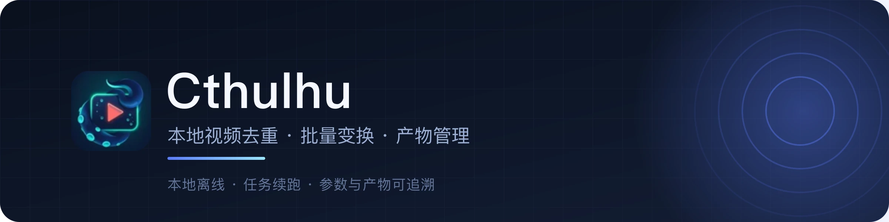
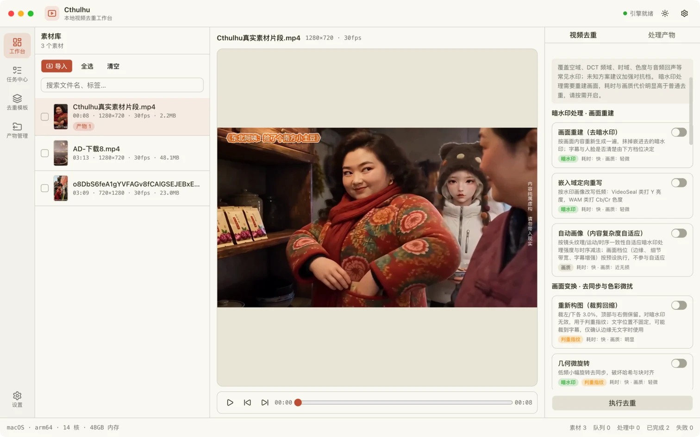
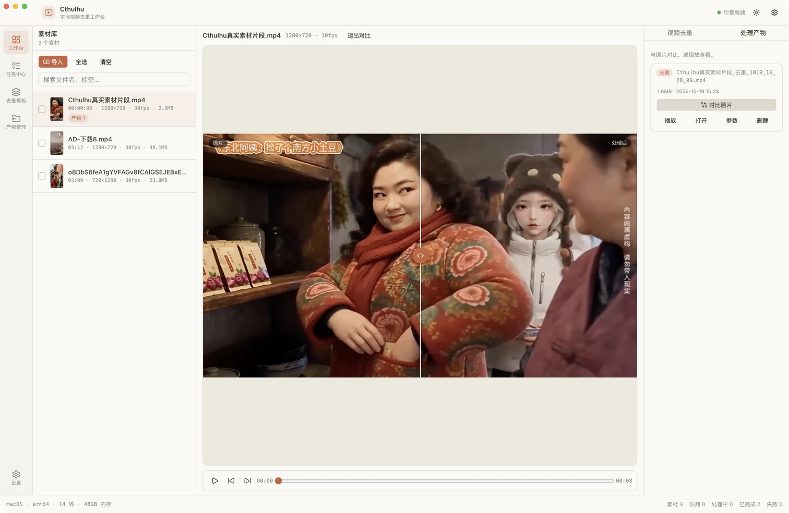
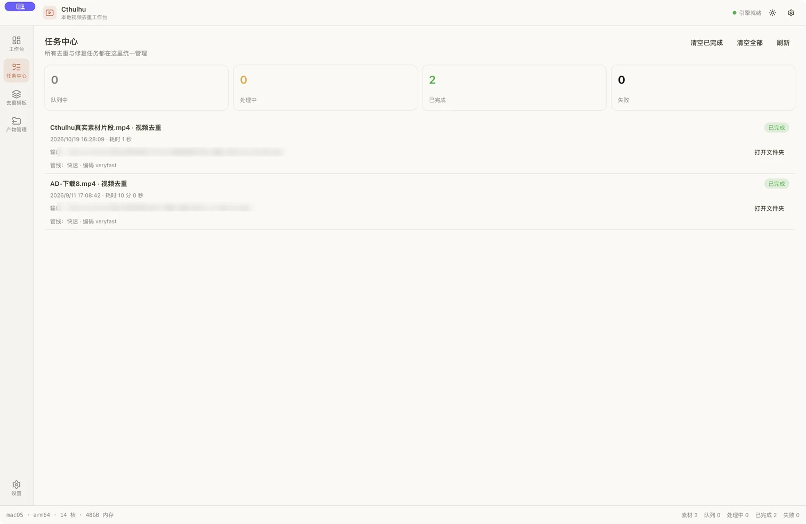
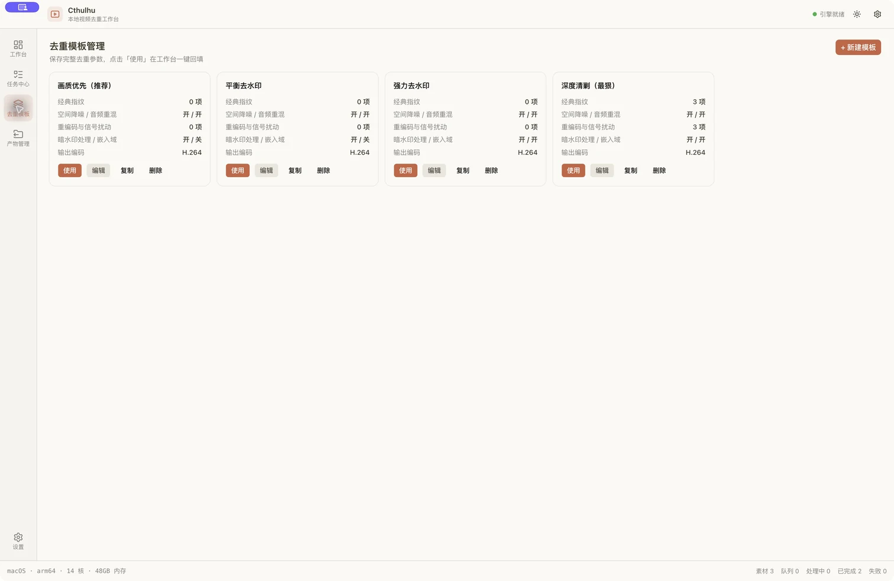
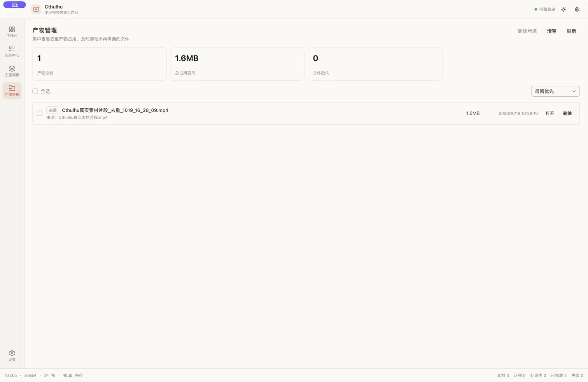
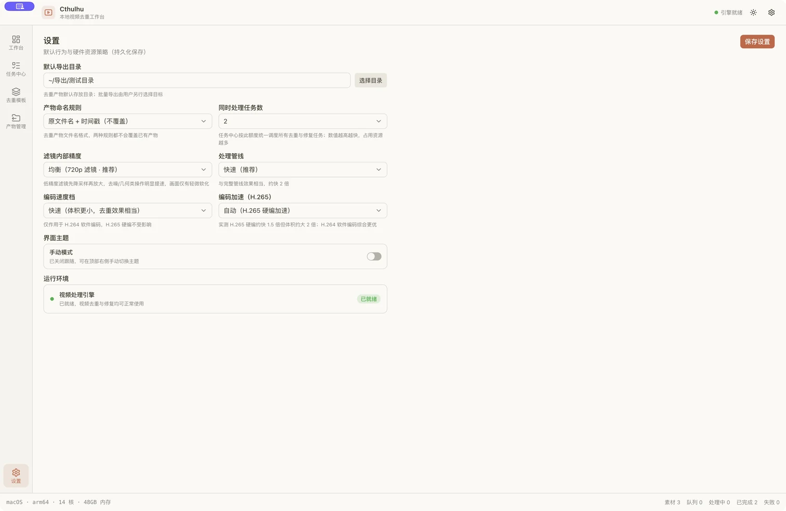

<p align="center">
  
</p>

<p align="center">
  <a href="docs/使用边界与合规声明.md"></a>
  
  
  
  
</p>

<p align="center">
  本地视频去重、批量变换与产物管理<br>
  素材和导出文件留在自己的电脑上
</p>

<p align="center">
  <picture>
    <source media="(prefers-color-scheme: dark)" srcset="docs/assets/screenshots/ui-workbench-dark.webp">
    
  </picture>
</p>

> **使用边界**：仅处理自有或已获授权的视频；严禁用于规避平台规则、去除版权 /
> 溯源标识、侵权搬运、账号矩阵规避或其他违法违规用途。完整说明见
> [使用边界与合规声明](docs/使用边界与合规声明.md)。

Cthulhu 是一个本地桌面工作台，把视频导入、播放预览、批量变换、任务调度和产物管理
收在同一个界面里。它适合整理同一素材的多个版本、批量生成独立的处理版本，并在导出
前后人工检查画面、参数和文件占用。

这里的“去重”有两层含义：

- 导入时根据文件内容签名跳过重复素材；
- 处理时为原片生成新的去重版本，不覆盖也不删除原片。

本地指标只描述文件与画面变化，不代表任何平台的实际判定。处理后的文件需要自行播放、
抽查和复核。

## 主要能力

### 素材库与预览

- 支持拖入文件、选择文件或递归选择文件夹导入。
- 支持 MP4 / MOV / MKV / AVI / FLV / TS，自动读取时长、分辨率、帧率、编码和大小。
- 导入时校验内容，跳过重复文件；素材库支持搜索、多选、全选与清空。
- 中间预览区支持播放 / 暂停、上一帧 / 下一帧和进度拖动。

### 视频去重工作台

- 可选择内置模板，也可展开手动参数逐项调整。
- 参数按“画面重建”“画面变换”“音频处理”“重编码与信号扰动”“画质优化”
  和“输出编码”分组，开关旁边会标注适用目标、耗时和画质代价。
- 支持 H.264 / H.265、原始分辨率 / 1920×1080 / 1280×720 和无损输出。
- 单个素材可直接处理；多选后可批量入队或批量导出。

当前桌面版可用的参数组包括：

| 分组 | 主要选项 |
| :--- | :--- |
| 画面重建 | 画面重建、嵌入域定向重写、自动画像、跨帧估计相减、FFT 相位扰动、小波与 DCT 扰动 |
| 画面变换 | 重新构图、几何微旋转、局部平滑扭曲、透视剪切、平移抖动、色彩微扰 |
| 音频处理 | 音频指纹处理、音频回声扰动 |
| 重编码与信号扰动 | 感知哈希对抗、多哈希对抗、噪声 / 重量化、伪水印压力测试、人脸扰动、神经对抗 |
| 画质优化 | PSNR / SSIM 门控、锐度补偿、色彩还原、空间降噪 |
| 输出编码 | H.264 / H.265、分辨率策略、无损输出 |

画面重建和神经类选项的耗时、画质代价明显高于普通重编码，建议先用短视频或低档强度
验证，再处理长素材。

### 任务中心

- 统一展示排队中、处理中、已完成和失败任务。
- 支持调整排队优先级、暂停、继续、取消、失败重试、清空已完成或清空全部记录。
- 显示创建时间、耗时、输出路径、处理管线和编码速度档，并可直接打开产物所在目录。
- 应用重启后会尝试续跑未完成任务，避免整批任务因中断全部作废。

### 模板

内置四个模板：

- 画质优先（推荐）
- 平衡去水印
- 强力去水印
- 深度清剿（最狠）

模板可以在工作台一键回填，也可以新建、编辑、复制和删除。不同模板的耗时和画质代价
差异较大，使用前应查看卡片上的参数概览。

### 产物管理

- 集中显示产物总数、总占用空间和文件缺失数量。
- 可按最新优先或体积优先排序。
- 可打开产物、删除单个或批量产物，并自动刷新素材库的产物数量。
- 在工作台的“处理产物”标签中，可播放产物、查看参数快照，或用滑块对比原片与处理后。

### 设置

- 自定义默认导出目录与产物命名规则，已有文件不会被覆盖。
- 设置同时处理任务数、滤镜内部精度、处理管线和编码速度档。
- 选择 H.265 编码使用 CPU 或自动硬编加速。
- 查询视频处理引擎状态；缺少 FFmpeg 时可在应用内尝试安装或选择本机可执行文件。

## 真实界面

以下截图来自当前桌面版，工作台和对比页使用本地真实视频；任务列表中的个人目录路径
已做模糊处理。

### 原片与处理产物对比

<p align="center">
  
  <br>
  <sub>同一时间轴上的滑块对比：左侧为原片，右侧为处理产物</sub>
</p>

### 任务中心

<p align="center">
  
</p>

### 去重模板

<p align="center">
  
</p>

### 产物管理

<p align="center">
  
</p>

### 设置

<p align="center">
  
</p>

## 典型使用流程

1. 导入视频或文件夹；重复内容会被跳过。
2. 选择素材，在中间预览确认画面与时长。
3. 选择模板或手动配置处理参数，点击“执行去重”。
4. 在任务中心查看进度；需要时可暂停、继续、取消或重试。
5. 在“处理产物”中播放或用滑块对比原片，确认观感与画质后可打开目录、继续处理或清理。

## 快速开始

环境要求：

- macOS Apple Silicon
- Node.js 22+、pnpm 11+
- uv（Python 3.12）
- FFmpeg 与 ffprobe

```bash
pnpm install
pnpm --dir ui install
pnpm --dir electron install

cd backend
uv sync --extra purify
cd ..

pnpm dev:desktop   # 桌面应用：Electron + Vite + Python 后端
```

只在浏览器中开发界面时使用：

```bash
pnpm dev           # http://localhost:5173
```

需要临时避开日常素材库时，可指定独立数据库：

```bash
CTHULHU_DB=/tmp/cthulhu-demo/cthulhu.db pnpm dev
```

## 打包

先准备静态 FFmpeg，再执行完整打包：

```bash
bash packaging/fetch_ffmpeg.sh
pnpm package
```

`pnpm package` 会构建前端、拉取画面的内置重建模型并打包 Python sidecar，最后生成
`packaging/dist/Cthulhu-<版本>-arm64.dmg`。当前 macOS 产物未签名、未公证；Windows
已有打包配置，但尚未在仓库中提供已验证的正式安装包。

## 开发与验证

技术栈：Electron + React 19（Vite） + Python 3.12 FastAPI sidecar + FFmpeg /
ONNX Runtime，本地数据使用 SQLite。

```bash
pnpm typecheck
pnpm test

cd backend
uv run ruff check src tests
uv run pytest tests -q
```

后端 CLI、REST / WebSocket 接口和模块说明见 [backend/README.md](backend/README.md)。

## 文档

- [文档索引](docs/README.md)
- [界面导览](docs/界面导览.md)
- [使用边界与合规声明](docs/使用边界与合规声明.md)
- [产品定位与架构](docs/产品定位与架构.md)
- [实施文档](docs/实施文档.md)
- [发布打包](docs/发布打包.md)
- [research/README.md](research/README.md)：研究档案与实验脚本

## 许可与使用边界

- 本仓库未附开源许可证，默认保留全部权利；许可范围外使用前请先与维护者确认。
- 仅处理自有或已获授权的素材；禁止规避平台规则、去除版权 / 溯源标识、侵权搬运、
  账号矩阵等用途。
- 不提供“保证过审”“保证不限流”“保证不被识别”等承诺；本地测试结果不代表平台结果。
