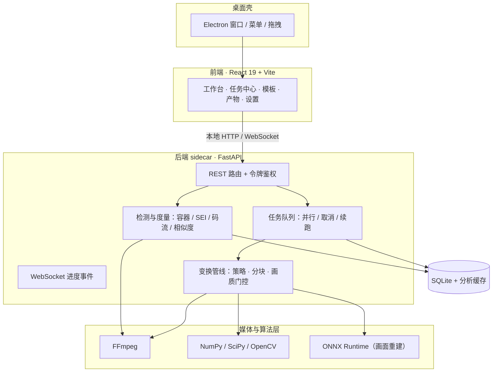

# Cthulhu · 产品定位与扩展架构

> 文档导航：[README](../README.md) · [文档索引](README.md) · [使用边界与合规声明](使用边界与合规声明.md) · [实施文档](实施文档.md) · [发布打包](发布打包.md) · [界面导览](界面导览.md)

> **使用边界声明**：本项目及仓库内全部文档仅供合法合规地处理**自有或已获授权的
> 素材**；严禁用于规避平台规则、去除版权/溯源水印、侵权搬运、账号矩阵规避、
> 欺诈或其他违法违规用途。完整边界见
> [使用边界与合规声明](使用边界与合规声明.md)，该声明优先于本文任何历史表述。

> 本文固化产品定位、设计原则、总体架构与扩展缝隙，供后续功能按统一方式接入。

## 一、定位

- 名称：Cthulhu
- 形态：macOS（Apple Silicon）本地离线桌面应用，单机安装包，双击即用
- 场景：面向自有或已获授权素材的本地视频去重与版本处理——素材库、重复文件识别与导入去重、
  画面重建与变换、相似度与画质度量、批量任务与产物管理；学术研究与教学场景同样适用
- 使用前提：仅处理自有素材或已获明确授权的素材（见
  [使用边界与合规声明](使用边界与合规声明.md)）
- 产品边界：本文所称「视频去重」指素材库内重复文件识别、导入去重与可追溯的
  版本生成；不指规避平台审核、版权识别或重复内容识别规则
- 能力标注：具体功能按目标层标注「暗水印」「判重指纹」等；暗水印画面重建
  涉及更高的耗时与画质代价，需在产品界面中明确说明
- 远期候选：公开数据集适配、可复现评估管理、差分分析方法、基准扩展
  （规划中，未定）

## 二、设计原则

1. 观感与可复现性并重：变换处理应尽量保持内容可用，并如实记录画质代价。
2. 证据驱动：效果以本地代理指标与回归门衡量；平台反馈只能在授权范围内解释。
3. 离线私有：素材不出本机，不依赖云服务或按次计费。
4. 流程简单、参数有边界：默认配置用于常规处理，极端配置仅限隔离研究。
5. 合规优先：任何与 [使用边界与合规声明](使用边界与合规声明.md) 冲突的用途
   均不得执行。

## 三、总体架构

开发模式下 Vite（5173）代理 `/api` 与 `/ws` 到 uvicorn（57173）；打包后由
FastAPI 托管前端静态资源，Electron 窗口加载本地地址。

## 四、扩展缝隙（新增功能应走的既有接口）

| 扩展点 | 位置 | 接入方式 |
|---|---|---|
| 新处理类型 | `jobs.RUNNERS` + `TaskSpec.kind` | 新增 runner 函数与 kind 枚举，入队即可用 |
| 新前端视图 | `ui/src/views/` + `Rail` 导航 | 新建视图组件并登记导航项 |
| 新变换策略 | `transform/strategies.py` | `register_strategy` 注册，按名称切换 |
| 新代理/模型 | `fingerprint/` + `deep.py` 样例 | ONNX Runtime 惰性加载，缺失自动降级 |
| 素材元数据 | `db.py` materials/reports | 后续加 tags/分组字段时迁移预留 |
| 设置与模板 | settings 键值 + templates payload | 参数化扩展，无需改表结构 |
| 进度事件 | `events.broker` + 任务队列 | 新任务复用进度/取消/暂停协议 |

约定：新处理类型必须复用任务队列（排队/并行/进度/取消/持久化），新算法
必须挂进回归门（`fingerprint gate`），新模型必须支持缺失降级，不把重依赖
（如 PyTorch）打进基础构建。
